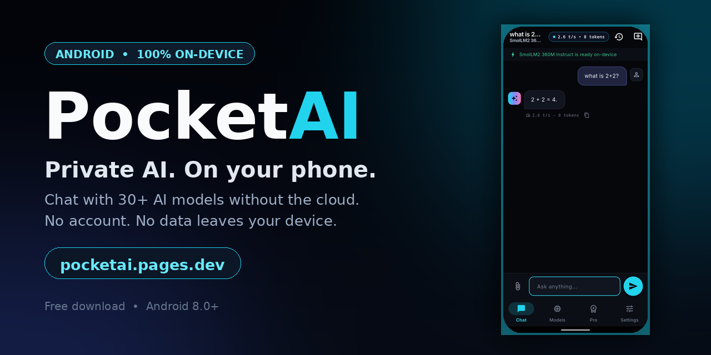
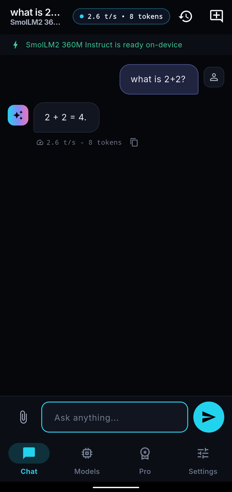
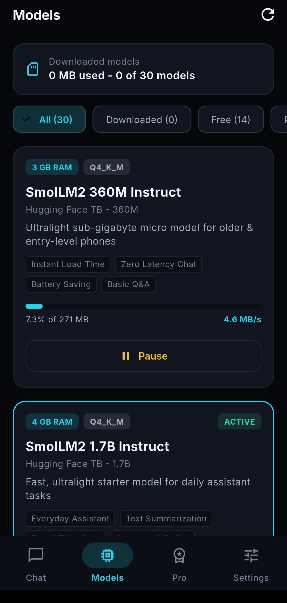
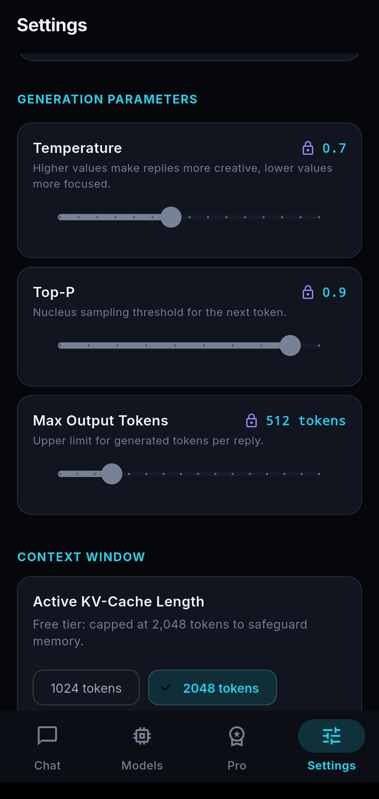

# PocketAI Android APK Download



Official distribution repository for **PocketAI** — a private, on-device AI workspace for Android.

PocketAI puts a full AI assistant on your phone. Pick a model, download it once, and chat offline — no account, no cloud, and nothing you type leaves your device.

- Official website: [https://pocketai.pages.dev](https://pocketai.pages.dev)
- Subscription and Pro: [https://pocketai.pages.dev/subscription.html](https://pocketai.pages.dev/subscription.html)
- Latest release: [pocketai.apk](https://github.com/rishibanota/pocketai-app-download/releases/latest/download/pocketai.apk)

---

## Direct Download

Download the production APK directly:

| Asset | Target architecture | Minimum Android |
| :--- | :--- | :--- |
| **`pocketai.apk`** | arm64-v8a / armeabi-v7a | Android 8.0+ (API 26+) |

Verify your download against `SHA256SUMS.txt` attached to the same release:

```bash
sha256sum -c SHA256SUMS.txt
```

---

## Screenshots

| Chat | Models | Settings |
| :---: | :---: | :---: |
|  |  |  |

## Watch the demo

[](media/pocketai_promo.mp4)

A 22-second tour of offline chat, the model library, and Pro controls.

---

## Installation Guide (Sideloading on Android)

1. Download **`pocketai.apk`** (~62 MB) to your Android phone.
2. Open the downloaded file from your notifications, Downloads, or a file manager.
3. If prompted with *"For your security, your phone is not allowed to install unknown apps from this source"*, tap **Settings** and allow installs from that source.
4. Tap **Install** and open **PocketAI**.
5. Go to the **Models** tab and download a starter model (for example SmolLM2 1.7B). Models range from about 0.5 GB to 4.5 GB and download in the app.

---

## Requirements

- Android 8.0 (API 26) or newer
- 64-bit ARM device (arm64-v8a) for on-device inference — this covers nearly all Android 8+ phones
- 4 GB RAM minimum for starter models; 6 GB+ recommended for larger Pro models
- Free storage for the app plus the models you choose to download

---

## Verification and Integrity

Every release artifact is signed and checksummed:

- Package name: `com.rishienterprises.pocketai`
- Signing: release keystore (SHA-256 certificate fingerprint `57:C0:D7:75:21:D6:CA:36:75:FA:62:1E:78:72:FE:D6:63:E8:75:28:DB:D4:E4:84:BF:0C:A1:E5:DC:AB:3E:9C`)
- Inference runtime: `llama.cpp` native GGUF engine (no cloud inference)
- Billing: Dodo Payments (subscription only; the app itself is free to use)
